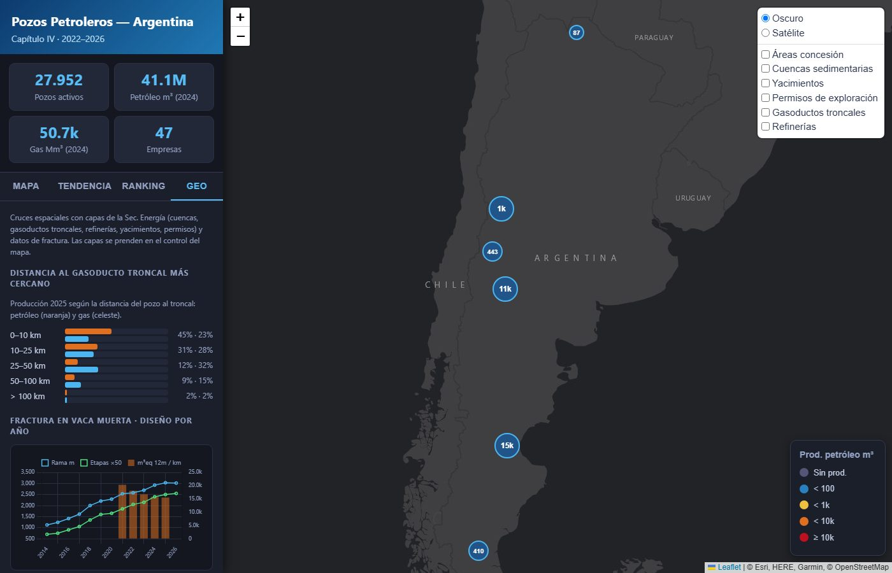

# Argentina Oil & Gas Explorer

Interactive web map of **Argentina's oil and gas wells and their monthly production**
(2022–2026), built from the open *Capítulo IV* dataset published by the Secretaría de Energía.
About 85k registered wells, ~28k producing per year, cross-referenced with sedimentary basins,
concessions, oil fields, exploration permits, gas trunk pipelines, refineries and hydraulic
fracturing data.

> Personal project, built with AI-assisted coding. Data processing and analysis are my own.


*The UI is in Spanish.*

## Features

**Map**
- **Well map** (Leaflet + marker clustering + canvas renderer) colour-coded by oil, gas,
  **GOR** (gas/oil ratio) or **water cut**; filters by year, basin, province, operator and
  resource type (conventional / unconventional).
- **Well popup** with production totals, GOR, water cut, a 24-month decline sparkline, its
  spatial context (basin polygon, oil field, exploration permit, distance to the nearest gas
  trunk pipeline and refinery) and, for fractured wells, the completion design (stages,
  lateral length, sand, water) and first-12-month production.
- **Layers**: national exploitation concessions (with km of field pipelines inside each one),
  sedimentary basins, oil fields, exploration permits, gas trunk pipelines (ENARGAS) and
  refineries.
- **Search by well code** (*sigla*), **time animation** of the last 24 months, **CSV export**
  of the current filtered view.

**Tabs**
- **Trends**: monthly production by basin and an operator comparison (top 15).
- **Ranking**: top producers and largest year-on-year rises / declines.
- **Geo**: share of production by distance to the gas trunk network; Vaca Muerta completion
  design over time (lateral length, stages) and 12-month productivity per km of lateral by
  operator; and a data-quality list of wells whose declared basin does not match the basin
  polygon that contains them.



**Data cleaning**
- Wells are keyed by `idpozo`: the well code (*sigla*) is **not unique** in the official
  register (≈7,250 wells share their code with another well), and joining on it
  double-counts production.
- Swapped lat/lon in the register are fixed (or dropped if unrecoverable); the trailing
  not-yet-reported month is trimmed from the series.
- Duplicated pipeline segments (same geometry loaded twice) are removed before measuring.

## Learning GeoPandas

[`docs/geopandas_guide.ipynb`](docs/geopandas_guide.ipynb) is a hands-on guide (in Spanish)
built on this project's data: reading layers and fixing encodings, `points_from_xy`, CRS and
projections, `sjoin`, `sjoin_nearest`, `overlay`, `dissolve`, and exporting light GeoJSON for
the web — plus the common pitfalls (swapped coordinates, measuring in degrees, non-unique keys).

## How it works

Python scripts preprocess the raw CSVs / shapefiles into small static files in `data/`
(`pozos_<year>.js`, `areas.geojson`, `sparklines.json`, `serie_*.json`, `ranking.json`,
`pozos_geo.json`, `fractura.json`, …). `index.html` is a single static page that loads them —
no backend. Spatial joins use GeoPandas; distances and lengths are computed in a Lambert
azimuthal equal-area projection centred on Argentina.

## How to run

### 1. Download the raw data into `data/`

From the Secretaría de Energía open data portal
([datos.energia.gob.ar](http://datos.energia.gob.ar/)), all CC-BY-4.0:

| File in `data/` | Dataset |
|---|---|
| `capitulo-iv-pozos.csv` | [Producción de petróleo y gas por pozo (Capítulo IV)](http://datos.energia.gob.ar/dataset/produccion-de-petroleo-y-gas-por-pozo) → *Capítulo IV - Pozos* (well register with coordinates) |
| `produccion-2022.csv` … `produccion-2026.csv` | Same dataset → *Producción de Pozos de Gas y Petróleo – <year>* (rename each file) |
| `concesiones_shp/concesiones.*` | [Concesiones de explotación](http://datos.energia.gob.ar/dataset/produccion-hidrocarburos-concesiones-de-explotacion) (SHP) |
| `geo/cuencas/cuencas.*` | [Cuencas sedimentarias](http://datos.energia.gob.ar/dataset/exploracion-hidrocarburos-cuencas-sedimentarias) (SHP) |
| `geo/yacimientos/yacimientos.*` | [Yacimientos](http://datos.energia.gob.ar/dataset/produccion-hidrocarburos-yacimientos) (SHP) |
| `geo/permisos/permisos.*` | [Permisos de exploración](http://datos.energia.gob.ar/dataset/exploracion-hidrocarburos-permisos-de-exploracion) (SHP) |
| `geo/gasoductos/gasoductos.*` | [Gasoductos de transporte (ENARGAS)](http://datos.energia.gob.ar/dataset/transporte-hidrocarburos-ductos-troncales-gasoductos) (SHP) |
| `geo/refinerias/refinerias.*` | [Refinerías](http://datos.energia.gob.ar/dataset/refinacion-hidrocarburos-refinerias) (SHP) |
| `geo/ductos319/ductos319.*` | [Ductos de hidrocarburos y agua (Res. 319/93)](http://datos.energia.gob.ar/dataset/instalaciones-hidrocarburos-ductos-res--319-93) (SHP, ~100 MB zipped) |
| `geo/fractura.csv` | [Datos de fractura de pozos (Adjunto IV)](http://datos.energia.gob.ar/dataset/datos-de-fractura-de-pozos-adjunto-iv) (CSV) |

Unzip each shapefile into its folder and rename the files to the name shown (e.g.
`geo/cuencas/cuencas.shp`, `.dbf`, `.shx`, `.prj`). The production CSVs are ~300 MB per year;
none of the data is committed to this repo.

### 2. Preprocess

```bash
python -m venv .venv
# Windows: .venv\Scripts\activate    Linux/macOS: source .venv/bin/activate
pip install -r requirements.txt

python preprocess.py            # pozos.js, cuencas_stats.json, top_empresas.json
python preprocess_peryear.py    # pozos_2022.js … pozos_2026.js (+ coordinate cleaning)
python preprocess_areas.py      # areas.geojson (concessions × wells)
python preprocess_ranking.py    # ranking.json
python preprocess_temporal.py   # serie_cuencas/empresas/nacional.json, sparklines.json
python preprocess_geo.py        # basins, fields, permits, pipelines, refineries (needs areas.geojson)
python preprocess_fractura.py   # fractura.json (fracturing × monthly production)
```

To run the GeoPandas guide: `pip install jupyter matplotlib` and open
`docs/geopandas_guide.ipynb`.

### 3. Serve

```bash
python -m http.server 8765
```

Open <http://localhost:8765>. (A local server is needed because the page fetches JSON files.)
After re-running the preprocess scripts, hard-refresh the page (Ctrl+F5) so the browser does
not keep cached data.

## Data sources and notes

- **Secretaría de Energía de la Nación (Argentina)** — *Capítulo IV* well register and monthly
  production sworn declarations, fracturing data (Adjunto IV), and the basins, concessions,
  fields, permits, pipelines and refineries layers. Open data (CC-BY-4.0); figures are as
  reported by operators and the latest month usually lags.
- Base maps: Esri World Dark Gray Canvas and Esri World Imagery.
- Units: oil and water in m³, gas in thousand m³ (Mm³), as in the source data. Oil-equivalent
  figures convert gas at 1,069 m³ of gas per m³ of oil (6 Mcf/bbl energy equivalence).
- Basin and pipeline polygons are simplified for the web; distances are approximate
  (equal-area projection, < 1 % scale error across the producing basins).
