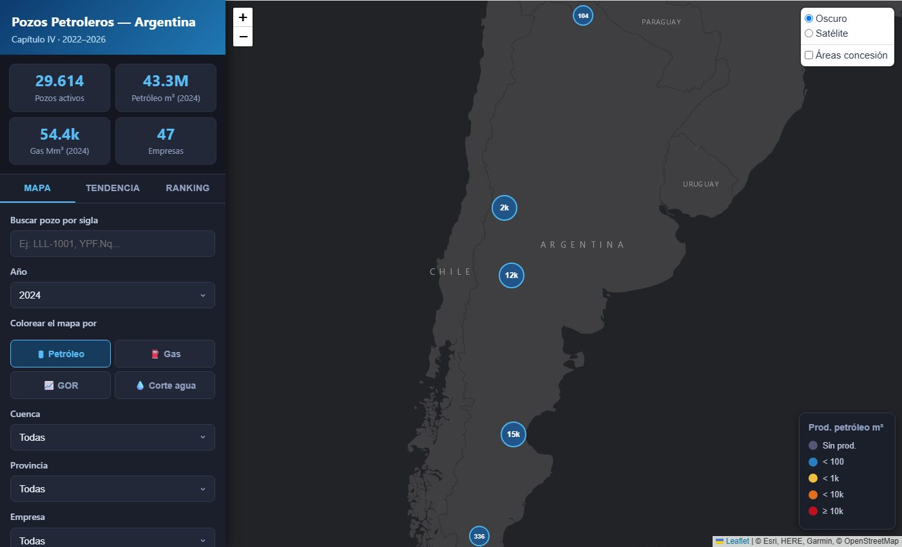

# Argentina Oil & Gas Explorer

Interactive web map of **Argentina's oil and gas wells and their monthly production**
(2022–2026), built from the open *Capítulo IV* dataset published by the Secretaría de Energía.
About 85k registered wells, ~30k producing per year, plus the national exploitation
concessions.

> Personal project, built with AI-assisted coding. Data processing and analysis are my own.



*The UI is in Spanish.*

## Features

- **Well map** (Leaflet + marker clustering + canvas renderer) colour-coded by oil, gas,
  **GOR** (gas/oil ratio) or **water cut**; filters by year, basin, province, operator and
  resource type (conventional / unconventional).
- **Well popup** with production totals, GOR, water cut and a 24-month decline sparkline.
- **Search by well code** (*sigla*) with fly-to.
- **Concession areas** layer (298 national exploitation concessions) enriched with number of
  wells, oil/gas totals, operator and unconventional share; click an area to filter its wells.
- **Time animation** of the last 24 months on the map.
- **Trends tab**: monthly production by basin and an operator comparison (top 15).
- **Ranking tab**: top producers and largest year-on-year rises / declines.
- **CSV export** of the current filtered view.
- Data cleaning: swapped lat/lon in the official register are fixed (or dropped if
  unrecoverable), and the trailing not-yet-reported month is trimmed from the series.

## How it works

Python scripts preprocess the raw CSVs / shapefiles into small static files in `data/`
(`pozos_<year>.js`, `areas.geojson`, `sparklines.json`, `serie_*.json`, `ranking.json`, …).
`index.html` is a single static page that loads them — no backend.

## How to run

### 1. Download the raw data into `data/`

From the Secretaría de Energía open data portal
([datos.energia.gob.ar](http://datos.energia.gob.ar/)):

| File in `data/` | Dataset |
|---|---|
| `capitulo-iv-pozos.csv` | [Producción de petróleo y gas por pozo (Capítulo IV)](http://datos.energia.gob.ar/dataset/produccion-de-petroleo-y-gas-por-pozo) → *Capítulo IV - Pozos* (well register with coordinates) |
| `produccion-2022.csv` … `produccion-2026.csv` | Same dataset → *Producción de Pozos de Gas y Petróleo – <year>* (rename each file) |
| `concesiones_shp/concesiones.shp` (+ .dbf/.shx/.prj/.cpg) | [Producción de hidrocarburos – concesiones de explotación](http://datos.energia.gob.ar/dataset/81cfad0a-4162-4f85-ad71-837f5a5fae57/resource/48a306a3-d5da-4f28-8ab5-7f80767ffdec/download/produccin-hidrocarburos-concesiones-de-explotacin.zip) (unzip and rename to `concesiones.*`) |

The production CSVs are ~300 MB per year; none of the data is committed to this repo.

### 2. Preprocess

```bash
python -m venv .venv
# Windows: .venv\Scripts\activate    Linux/macOS: source .venv/bin/activate
pip install -r requirements.txt

python preprocess.py           # pozos.js, cuencas_stats.json, top_empresas.json
python preprocess_peryear.py   # pozos_2022.js … pozos_2026.js (+ coordinate cleaning)
python preprocess_areas.py     # areas.geojson (concessions × wells)
python preprocess_ranking.py   # ranking.json
python preprocess_temporal.py  # serie_cuencas/empresas/nacional.json, sparklines.json
```

### 3. Serve

```bash
python -m http.server 8765
```

Open <http://localhost:8765>. (A local server is needed because the page fetches JSON files.)

## Data sources and notes

- **Secretaría de Energía de la Nación (Argentina)** — *Capítulo IV* well register and monthly
  production sworn declarations (Res. SE 319/93), and the national concessions layer. Data is
  published as open data; figures are as reported by operators and the latest month usually
  lags.
- Base maps: Esri World Dark Gray Canvas and Esri World Imagery.
- Units: oil and water in m³, gas in thousand m³ (Mm³), as in the source data.
